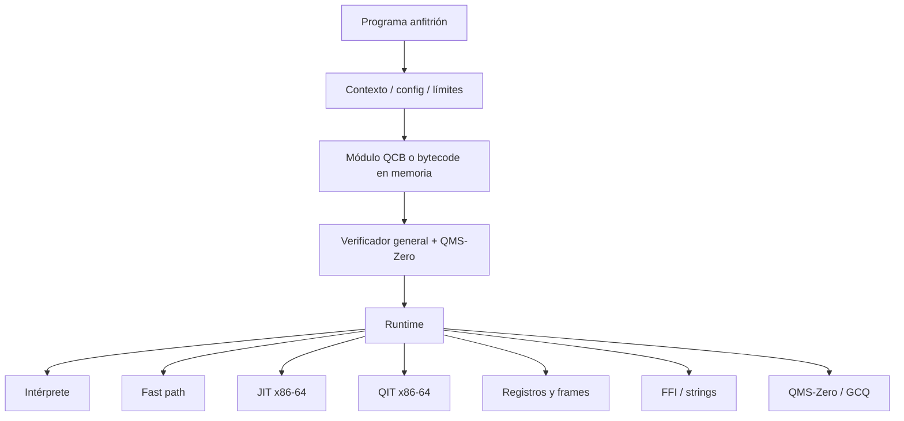

# QVM

<p align="center">
  <strong>Máquina virtual de bytecode embebible, escrita en C17, con ejecución intérpreta, fast path y traducción a código nativo x86-64.</strong>
</p>

<p align="center">
  
  
  
  
  
</p>

QVM es un motor, no un lenguaje: el programa anfitrión genera bytecode y usa la biblioteca estática `qvm_core` para cargarlo, verificarlo y ejecutarlo. El repositorio incluye el intérprete, un *fast path* con *computed goto*, dos backends JIT y un subsistema de memoria con verificación estática (QMS-Zero).

> :white_check_mark: **Estado del repositorio**: `v0.1.0-dev`, 17/17 tests, licencia MIT y `tests/` versionado, por lo que un clon limpio puede compilar. Consulta [estado y reproducibilidad](docs/benchmarks.md).

## Índice

- [Características](#características)
- [Inicio rápido](#inicio-rápido)
- [Arquitectura](#arquitectura)
- [Componentes](#componentes)
- [QVM en acción](#qvm-en-acción)
- [Documentación](#documentación)
- [Estado del proyecto](#estado-del-proyecto)
- [Contribución y licencia](#contribución-y-licencia)

## Características

| Capacidad | Detalle | Referencia |
|:---|:---|:---|
| ISA propia | 34 opcodes: control, aritmética, comparación, lógica, CAST, strings, FFI y memoria | [arquitectura.md §4](docs/arquitectura.md#4-conjunto-de-instrucciones-isa) |
| Tipado | Tipos nativos y extendidos, `i128/u128` en pares de registros | [arquitectura.md §3](docs/arquitectura.md#3-sistema-de-tipos-y-valores) |
| Módulos QCB | Formato binario con secciones de constantes, funciones y bytecode | [arquitectura.md §5](docs/arquitectura.md) |
| Verificación | Validación de bytecode en carga y verificador específico de memoria | [arquitectura.md §6](docs/arquitectura.md#6-verificación) |
| Cuatro backends | Intérprete, fast path, JIT y QIT | [qit.md](docs/qit.md) |
| Memoria | QMS-Zero (bump + verificación estática) y GCQ (allocator con contabilidad) | [qms-zero.md](docs/qms-zero.md) |
| Interoperabilidad | Registro FFI de funciones C y strings nativos con refcount | [api.md §6](docs/api.md) |

## Inicio rápido

Requisitos: CMake ≥ 3.16, compilador C17 (GCC/Clang) y Linux x86-64 para los backends nativos.

```bash
git clone https://github.com/ZCodeGX/QVM.git
cd QVM

cmake -S . -B build -DCMAKE_BUILD_TYPE=Release
cmake --build build -j$(nproc)
ctest --test-dir build --output-on-failure

./build/test_qms_simple
./build/benchmark_native
```

Alternativamente, `./install.sh` configura, compila, ejecuta los tests y lanza `benchmark_optimized` en un solo paso.

<details>
<summary>Ver detalle de la instalación y enlazado</summary>

```bash
# El script requiere cmake y gcc/clang
./install.sh

# Enlazar un programa propio contra la librería estática
cc -std=c17 -Iinclude mi_programa.c build/libqvm_core.a -o mi_programa
```

`qvm_core` expone `include/` mediante `target_include_directories(... PUBLIC include)` (`CMakeLists.txt:32`). Los ejemplos ejecutables se registran en `CMakeLists.txt`.

</details>

Un programa mínimo que suma dos registros y lee el resultado está en [api.md §4](docs/api.md#4-ejemplo-completo-suma-desde-bytecode-en-memoria).

## Arquitectura



El flujo de ejecución, la codificación de instrucciones y el formato QCB se describen con detalle en [docs/arquitectura.md](docs/arquitectura.md).

## Componentes

| Componente | Qué es | Cuándo usarlo |
|:---|:---|:---|
| **QVM** | Núcleo: contexto, ISA, loader, runtime, FFI, strings y memoria | Siempre; es la biblioteca base |
| **QIT** | *QVM Inline Translation*: emite x86-64 con saltos `rel32` y W^X | Bucles cálidos con `ADD`/`CMP_LT`/`JMP_IF`/`RETURN` |
| **JIT básico** | Generador x86-64 más simple, con saltos `rel8` | Experimentación; cubre el mismo subset que QIT |
| **QMS-Zero** | Regiones *bump* y punteros validados estáticamente; accesos sin checks en runtime | Bytecode que debe pasar previamente por `qvm_verify_qms_module` |
| **GCQ** | Allocator con límite, bloques regionales y liberación O(n) | Gestión general de memoria del contexto |

> El nombre usado en código, commits y tests es **QMS-Zero**. La forma `QSM-Zero` no aparece en el repositorio.

## QVM en acción

Resultados reales del repositorio en este entorno (100 M iteraciones, `Release`, una medición por caso):

| Modo | M iter/s | Ratio de tiempo sobre C |
|:---|---:|---:|
| C puro (`volatile`) | 2407.90 | 1.00x |
| QVM fast path, registros | 71.52 | 33.67x |
| QVM fast path, QMS-Zero | 44.74 | 48.96x |
| QVM intérprete, registros | 22.97 | — |
| QVM JIT | 852.53 | 2.72x |
| QVM QIT | 1076.53 | 2.19x |

No se incluye una comparativa con C++ o JVM: el repositorio no contiene implementaciones ni harness para esos entornos, y cualquier cifra sería especulativa. La metodología completa, las salidas observadas y las limitaciones están en [docs/benchmarks.md](docs/benchmarks.md).

## Documentación

| Documento | Contenido |
|:---|:---|
| [Arquitectura](docs/arquitectura.md) | Capas, ciclo de vida, ISA, codificación, QCB, loader, runtime y mapa de fuentes |
| [API de QVM](docs/api.md) | Referencia práctica, ejemplo de integración, FFI y reglas de propiedad |
| [QIT](docs/qit.md) | Generación de código x86-64, ABI, parcheo de saltos y diferencias con el JIT |
| [QMS-Zero](docs/qms-zero.md) | Modelo de regiones, verificador, contrato de seguridad y limitaciones |
| [Benchmarks](docs/benchmarks.md) | Medición real, reproducción y estado del repositorio |

## Estado del proyecto

- [x] Biblioteca `qvm_core` y API pública en `include/qvm/`.
- [x] Intérprete, fast path, JIT y QIT.
- [x] Loader QCB, verificador general y verificador QMS-Zero.
- [x] FFI, strings nativos y tabla de tipos extendidos.
- [x] 17 tests CTest en el árbol de trabajo local.
- [x] Versionar `tests/` y corregir `.gitignore`.
- [ ] Corregir la serialización de constantes en `demo.c`, `demo_ffi.c` y `demo_strings.c`.
- [ ] Unificar la codificación de opcode QMS-Zero entre verificador y fast path.
- [x] Licencia MIT (`LICENSE`).
- [ ] Añadir CI y benchmarks C++/JVM si se desea comparar esos entornos.

## Contribución y licencia

Las contribuciones deben conservar el estilo C17 existente, compilar con `-Wall -Wextra -Wpedantic` y pasar `ctest --test-dir build --output-on-failure`. Antes de proponer cambios de comportamiento, consulta el contrato de seguridad de [QMS-Zero](docs/qms-zero.md#5-limitaciones-y-contrato-de-seguridad).

Distribuido bajo la [licencia MIT](LICENSE). Copyright (c) 2026 amine.
