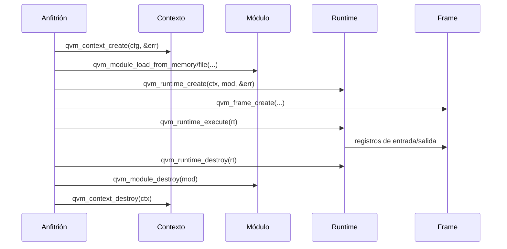

# Referencia de API de QVM

> Guía práctica para embeber QVM en un programa C o C++. Todas las cabeceras usan `extern "C"` (salvo los helpers de prueba de `instruction.h:95-97`), por lo que enlazar desde C++ requiere `extern "C"` al incluir.
> Versión reportada: `qvm_version()` → `"0.1.0-dev"` (`src/core/version.c:3-5`).

## 1. Modelo de integración

QVM no compila código fuente: el anfitrión entrega **bytecode**. El flujo mínimo es:



Alternativamente se puede construir `qvm_module` directamente en memoria, como hacen los benchmarks: asignar `calloc`, rellenar `bytecode`, `bytecode_size` y, si aplica, `constants`/`functions`.

## 2. Cabeceras y responsabilidades

| Cabecera | Responsabilidad | Símbolos principales |
|:---|:---|:---|
| `qvm/qvm.h` | Umbrella | Incluye el resto; `qvm_version()` |
| `qvm/config.h`, `qvm/limits.h` | Configuración y límites | `qvm_config_default()`, `qvm_limits_default()`, `qvm_mode` |
| `qvm/context.h`, `qvm/lifecycle.h` | Contexto y estados | `qvm_context_create/destroy`, `qvm_init/start/stop/reset`, `qvm_state_of` |
| `qvm/types.h`, `qvm/type_table.h` | Tipos nativos y extendidos | `qvm_type_id_t`, `qvm_type_table_add/find` |
| `qvm/value.h`, `qvm/registers.h` | Valores y registros | `qvm_value_make`, `qvm_value_as_*`, `qvm_register_read/write` |
| `qvm/frames.h` | Frames tipados | `qvm_frame_create/destroy`, `qvm_frame_registers` |
| `qvm/instruction.h` | ISA y decoder | `qvm_instruction_decode/execute/validate`, `qvm_opcode_name` |
| `qvm/qcb.h`, `qvm/loader.h` | Formato y carga | `qvm_module_load_from_file/memory`, `qvm_module_destroy` |
| `qvm/verifier.h` | Verificación general | `qvm_verify_module`, `qvm_verifier_result` |
| `qvm/runtime.h` | Ejecución | `qvm_runtime_create/destroy`, `qvm_runtime_execute`, `qvm_runtime_ffi` |
| `qvm/ffi.h` | Llamadas nativas | `qvm_ffi_register/find`, `qvm_native_fn` |
| `qvm/string.h` | Strings con refcount | `qvm_string_create/retain/release/concat/slice/compare` |
| `qvm/memory.h`, `qvm/gcq.h` | QMS-Zero y GCQ | `qvm_region_*`, `qvm_ptr_read/write`, `gcq_alloc/free` |
| `qvm/jit.h`, `qvm/qit.h` | Backends nativos | `qvm_jit_compile`, `qit_compile, qit_get_entry` |
| `qvm/error.h` | Errores | `qvm_error`, `qvm_error_name`, `qvm_error_message` |

## 3. Contexto y errores

```c
qvm_error err = QVM_OK;
qvm_context *ctx = qvm_context_create(NULL, &err);   /* NULL = configuración por defecto */
if (!ctx) {
    fprintf(stderr, "QVM: %s\n", qvm_error_message(err));
    return 1;
}
```

`qvm_error` incluye `INVALID_ARGUMENT`, `OUT_OF_MEMORY`, `INVALID_BYTECODE`, `VERIFICATION_FAILED`, `TYPE_MISMATCH`, `STACK_OVERFLOW`, `CALL_DEPTH_EXCEEDED`, `LIMIT_EXCEEDED`, `LOW_LEVEL_DISABLED`, `NULL_REFERENCE`, `INVALID_CHAR`, `INVALID_BOOL`, `MODULE_INCOMPATIBLE`, `IO`, `OUT_OF_BOUNDS` e `INTERNAL` (`include/qvm/error.h:10-28`).

La configuración por defecto es `SAFE` con `verify_on_load = 1` (`src/core/config.c:5-13`). Para cargar módulos sin verificación, hay que crear un `qvm_config` propio y poner `verify_on_load = 0`; no se recomienda fuera de entornos controlados.

## 4. Ejemplo completo: suma desde bytecode en memoria

Este patrón es el de `examples/benchmark_optimized.c:25-90` y no depende del loader QCB.

```c
#include <stdint.h>
#include <stdio.h>
#include <stdlib.h>
#include <string.h>
#include "qvm/qvm.h"
#include "qvm/instruction.h"

static void w16(uint8_t *b, uint16_t v) {
    b[0] = (uint8_t)v; b[1] = (uint8_t)(v >> 8);
}

int main(void) {
    uint8_t bc[16];
    uint32_t n = 0;

    /* r2 = r0 + r1 ; RETURN r2 */
    bc[n++] = QVM_OP_ARITH_ADD; bc[n++] = 2;
    w16(bc + n, QVM_TYPE_I32); n += 2;
    bc[n++] = 0; bc[n++] = 1;

    bc[n++] = QVM_OP_RETURN; bc[n++] = 0xFF;   /* dst no usado por el intérprete */
    w16(bc + n, QVM_TYPE_I32); n += 2;
    bc[n++] = 2;                               /* src1: registro devuelto */

    qvm_error err;
    qvm_context *ctx = qvm_context_create(NULL, &err);

    qvm_module *mod = calloc(1, sizeof *mod);
    mod->bytecode = malloc(n);
    memcpy((void *)mod->bytecode, bc, n);
    mod->bytecode_size = n;

    qvm_runtime *rt = qvm_runtime_create(ctx, mod, &err);
    qvm_type_id_t types[3] = { QVM_TYPE_I32, QVM_TYPE_I32, QVM_TYPE_I32 };
    qvm_frame *frame = qvm_frame_create(0, 3, types, NULL, &err);
    qvm_register_write(frame, 0, qvm_value_make(QVM_TYPE_I32, 2));
    qvm_register_write(frame, 1, qvm_value_make(QVM_TYPE_I32, 3));

    rt->call_stack[0] = frame;
    rt->call_depth = 1;
    rt->pc = 0;

    err = qvm_runtime_execute(rt);
    if (err == QVM_OK)
        printf("2 + 3 = %d\n", qvm_value_as_i32(&rt->return_value)); /* 5 */

    qvm_runtime_destroy(rt);   /* destruye los frames de la pila */
    free((void *)mod->bytecode);
    free(mod);
    qvm_context_destroy(ctx);
    return err != QVM_OK;
}
```

> **Detalle de ABI**: el intérprete toma el registro de `RETURN` de `src1` (`runtime.c:417-419`), mientras QIT lo toma del byte `dst` (`src/qit/qit.c:106-111`). Si el mismo bytecode se va a ejecutar en ambos backends, conviene escribir el mismo índice en `bytecode[1]` y `bytecode[4]`.

## 5. Cargar un módulo QCB

```c
qvm_module *mod = qvm_module_load_from_file("programa.qcb", ctx, &err);
if (!mod) { /* err contiene el motivo */ }

qvm_runtime *rt = qvm_runtime_create(ctx, mod, &err);
```

El loader valida magic (`0x524D4151`, "QARM" en little-endian) y versión 1, y aplica `qvm_verify_module` cuando `verify_on_load` está activo (`src/loader/loader.c:131-225`). Las constantes se codifican como `type_id:u16` seguido de `payload:u64` (o `len:u32 + bytes` para strings). Los ejemplos `demo.c`, `demo_ffi.c` y `demo_strings.c` usan un formato antiguo de 16 bytes por constante y actualmente fallan con `invalid bytecode`.

## 6. Llamadas a código nativo (FFI)

```c
qvm_error print_impl(qvm_frame *frame, const qvm_value *args,
                     uint32_t arg_count, qvm_value *result) {
    if (arg_count < 1) return QVM_ERR_INVALID_ARGUMENT;
    printf("%s\n", (const char *)(uintptr_t)qvm_value_as_u64(&args[0]));
    return QVM_OK;
}

qvm_ffi_registry *ffi = qvm_runtime_ffi(rt);
qvm_ffi_register(ffi, &(qvm_native_function){
    .name = "print", .fn = print_impl,
    .return_type = QVM_TYPE_VOID, .arg_count = 1,
    .arg_types = (qvm_type_id_t[]){ QVM_TYPE_PTR }
});
```

Desde bytecode se invoca con `CALL_NATIVE` (`0x05`); el runtime resuelve el nombre en el registro. Véase `examples/demo_ffi.c`.

## 7. Reglas de propiedad

- `qvm_runtime_destroy` destruye los frames que están en `call_stack` hasta `call_depth` (`runtime.c:57-68`): no los destruyas dos veces.
- `qvm_module_destroy` solo debe llamarse si el módulo fue creado por el loader; para módulos construidos a mano libera `bytecode` y el propio `qvm_module`.
- `qvm_frame_create` copia `register_types`; el array de tipos puede liberarse justo después.
- Las `qvm_string` usan refcount: `qvm_string_retain` / `qvm_string_release`.
- `qit_destroy` es obligatorio tras la ejecución; libera la región `mmap`.
- En QMS-Zero, `FREE` no devuelve memoria al sistema: marca el puntero como consumido y la región sigue creciendo.

## 8. Compilación y enlazado

```bash
cmake -S . -B build -DCMAKE_BUILD_TYPE=Release
cmake --build build -j$(nproc)
cc -std=c17 -Iinclude mi_programa.c build/libqvm_core.a -o mi_programa
```

El objetivo `qvm_core` es una librería estática; `target_include_directories(qvm_core PUBLIC include)` expone `include/` (`CMakeLists.txt:32`). Para usar QIT/JIT hay que enlazar además sus fuentes; están añadidas a `qvm_core` en `CMakeLists.txt:132-143`.

## 9. Superficie no implementada

No hay en este repositorio un compilador de lenguaje de alto nivel, ensamblador de texto, generador de `.qcb` ni intérprete interactivo. Tampoco hay integración con C++/JVM: el proyecto expone una ABI C que puede consumirse desde C++, pero no incluye fuentes C++ ni integración con JVM. Para escribir programas QVM hay que generar bytecode manualmente o con una herramienta externa.
