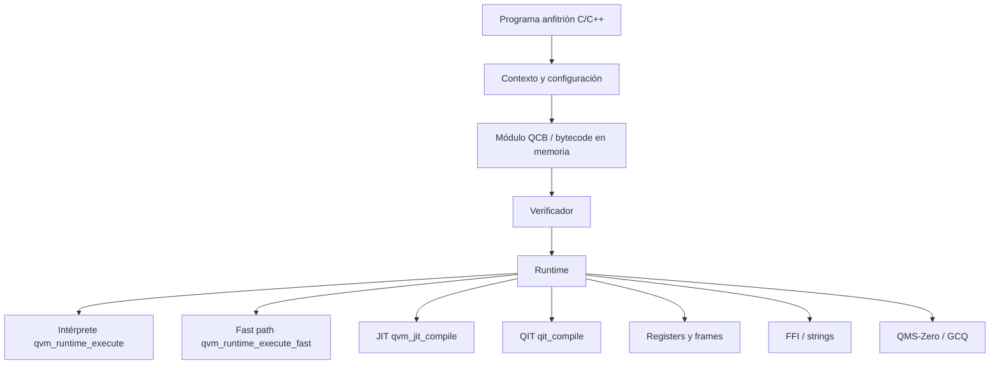

# Arquitectura de QVM

> Documento técnico de referencia. Describe el estado del código en `HEAD = 17cd281` (`v0.1.0-dev`).
> Las citas `archivo:línea` permiten contrastar cada afirmación con la implementación.

## 1. Alcance y modelo mental

QVM es una máquina virtual de bytecode escrita en C17 y distribuida como biblioteca estática `qvm_core`. No es un lenguaje ni un compilador: **es un motor embebible**. El programa anfitrión construye (o carga) un módulo, crea un contexto, un runtime y uno o más frames, y ejecuta bytecode con uno de varios backends.

El núcleo está en `src/`; la API pública en `include/qvm/`. El punto de entrada único es `include/qvm/qvm.h:4-21`, que agrupa las 18 cabeceras públicas y declara `qvm_version()` (`src/core/version.c:3-5`).

## 2. Contexto, configuración y ciclo de vida

`qvm_context` es opaco (`include/qvm/context.h:14`) y contiene configuración, límites, tabla de tipos y allocator. La API de ciclo de vida es `qvm_init`, `qvm_start`, `qvm_stop`, `qvm_reset` y `qvm_state_of` (`include/qvm/lifecycle.h:11-16`).

| Estado | Valor | Significado |
|:---|---:|:---|
| `QVM_STATE_CREATED` | 0 | Contexto asignado; todavía no ejecuta |
| `QVM_STATE_READY` | 1 | Inicializado, listo para arrancar |
| `QVM_STATE_RUNNING` | 2 | Operativo |
| `QVM_STATE_STOPPED` | 3 | Detenido |
| `QVM_STATE_FAILED` | 4 | Error irrecuperable |

Fuente: `include/qvm/context.h:17-23`.

`qvm_config_default()` (`src/core/config.c:5-13`) selecciona `QVM_MODE_SAFE`, `verify_on_load = 1` y metadatos de depuración activados. Los límites por defecto (`src/core/limits.c:5-16`) son:

| Límite | Valor |
|:---|---:|
| `max_memory_bytes` | 1 GiB |
| `max_call_depth` | 1024 |
| `max_registers_per_frame` | 4096 |
| `max_frame_slots` | 4096 |
| `max_bytecode_bytes` | 64 MiB |
| `max_constants` | 65536 |
| `max_functions` | 8192 |
| `max_modules` | 256 |
| `max_string_length` | 1 MiB |
| `max_gcq_handles` | 1048576 |

El modo (`PRODUCTION`, `SAFE`, `MIXED`) y `low_level` están definidos en `include/qvm/config.h:12-25`. Un embedder puede sustituir la configuración completa en `qvm_context_create(cfg, err)`.

## 3. Sistema de tipos y valores

- `qvm_type_id_t` es `uint16_t`. Los identificadores nativos van de `VOID (0x0000)` a `STRING (0x0011)` y los extendidos comienzan en `0x1000` (`include/qvm/types.h:11-47`).
- `qvm_type_entry` modela categoría, banderas, tamaño, alineación, nombre y campos; `qvm_type_table` permite `find`, `find_by_name`, `add` y `clear` (`include/qvm/type_table.h:12-20`). Flags: `BY_VALUE`, `BY_REFERENCE`, `COPY_SEMANTICS`, `DROP_SEMANTICS`.
- La unidad mínima de almacenamiento es `qvm_slot` (8 bytes). `qvm_value` contiene `payload:u64`, `type_id`, `flags` y `_reserved` (`include/qvm/value.h:13-24`). Los flags son `NONE`, `CONST`, `OWNED`, `BORROWED` y `GCQ_ROOT`.
- `qvm_register` es un alias de `qvm_value`. `qvm_register_read/write` y las variantes `read_pair/write_pair` soportan `i128/u128` ocupando dos registros contiguos (`include/qvm/registers.h:14-22`).
- `qvm_frame` es opaco; `qvm_frame_create(function_index, register_count, register_types, caller, err)` copia los tipos y zero-inicializa los registros (`include/qvm/frames.h:16-29`). Cada frame se asocia a una región WM de QMS-Zero.

## 4. Conjunto de instrucciones (ISA)

Definido en `include/qvm/instruction.h:14-66`.

| Grupo | Opcodes |
|:---|:---|
| Control de flujo | `JMP 0x01`, `JMP_IF 0x02`, `JMP_IF_NOT 0x03`, `CALL 0x04`, `CALL_NATIVE 0x05`, `RETURN 0x06`, `RETURN_VOID 0x07` |
| Movimiento | `MOV 0x10`, `LOAD_CONST 0x11` |
| Aritmética | `ADD 0x20`, `SUB 0x21`, `MUL 0x22`, `DIV 0x23`, `MOD 0x24`, `NEG 0x25` |
| Comparación | `EQ 0x30`, `NE 0x31`, `LT 0x32`, `LE 0x33`, `GT 0x34`, `GE 0x35` |
| Lógica | `AND 0x40`, `OR 0x41`, `NOT 0x42` |
| Conversión | `CAST 0x50` |
| Strings | `STR_CONCAT 0x60`, `STR_LEN 0x61`, `STR_CHAR_AT 0x62`, `STR_SLICE 0x63`, `STR_CMP 0x64` |
| QMS-Zero | `ALLOC 0x70`, `FREE 0x71`, `LOAD_PTR 0x72`, `STORE_PTR 0x73` |

`QVM_INSN_NO_REG = 0xFF` marca ausencia de registro (`instruction.h:12`). La API de instrucciones expone `qvm_instruction_decode`, `qvm_instruction_execute`, `qvm_instruction_validate`, `qvm_instruction_result_type`, `qvm_opcode_name` y `qvm_instruction_free` (`instruction.h:92-97`).

### 4.1 Codificación binaria

El decoder es little-endian (`src/instruction/decode.c:5-11`). Los tamaños que acepta `qvm_instruction_decode` son:

| Tamaño | Opcodes | Layout |
|---:|:---|:---|
| 4 B | `RETURN_VOID` | `[op]` |
| 5 B | `MOV`, `CAST`, `NEG`, `NOT`, `RETURN`, `STR_LEN`, `FREE` | `[op, dst, type_id:u16, src1]` |
| 6 B | `ADD`…`MOD`, `EQ`…`GE`, `AND`, `OR`, `STR_*` (salvo `LEN`) | `[op, dst, type_id:u16, src1, src2]` |
| 8 B | `LOAD_CONST`, `JMP`, `ALLOC` | `[op, dst, type_id:u16, imm32]` |
| 9 B | `JMP_IF`, `JMP_IF_NOT` | `[op, dst, type_id:u16, src1, imm32]` |
| 9 + N | `CALL`, `CALL_NATIVE` | `[op, dst, type_id:u16, imm32, arg_count, args[0..3]]` |
| 9 B | `LOAD_PTR`, `STORE_PTR` | `[op, dst, src, type_id:u16, imm32]` |

Fuente: `src/instruction/decode.c:22-100`. Los cuatro argumentos como máximo y el orden de campos distinto de `LOAD_PTR/STORE_PTR` son detalles críticos al generar bytecode a mano.

## 5. Formato de módulo QCB y carga

`include/qvm/qcb.h:11-32` define:

- `QCB_MAGIC = 0x524D4151` (en little-endian, bytes `QARM`), `QCB_VERSION_1_0 = 1`.
- Flags: `REQUIRE_SAFE = 0x1`, `DEBUG_METADATA = 0x2`.
- Secciones: `TYPES = 1`, `CONSTANTS = 2`, `FUNCTIONS = 3`, `BYTECODE = 4`.
- `qcb_header`: 16 bytes (`magic`, `version`, `flags`, `section_count`); `qcb_section_header`: 8 bytes (`type_id`, `size_bytes`).

Layout de las secciones interpretadas por el loader (`src/loader/loader.c`):

| Sección | Entrada |
|:---|:---|
| `CONSTANTS` | `type_id:u16`; si es string: `len:u32 + bytes`, si no: `payload:u64` (`loader.c:16-82`) |
| `FUNCTIONS` | `bytecode_offset:u32`, `param_count:u16`, `local_count:u16`, `return_type:u16`, seguido de `local_count` tipos de 2 bytes (`loader.c:84-129`) |
| `BYTECODE` | Bloque plano de instrucciones; los offsets de función apuntan dentro de él |

`qvm_module_load_from_file` y `qvm_module_load_from_memory` validan magic/versión, copian los datos a `owned_data` y, si `verify_on_load` está activo, ejecutan `qvm_verify_module` antes de devolver el módulo (`src/loader/loader.c:131-225`). `qvm_module_destroy` libera strings, tipos locales y buffers poseídos (`loader.c:271-294`). La sección `TYPES` está declarada pero **no se parsea** actualmente.

## 6. Verificación

`qvm_verify_module` (`src/verifier/verifier.c:50-123`) realiza una pasada lineal sobre el bytecode:

1. Comprueba argumentos y bytecode no vacío.
2. Decodifica cada instrucción; un opcode inválido detiene la verificación.
3. Valida índices de constantes en `LOAD_CONST`, destinos de salto dentro del bytecode, índice de función y aridad en `CALL`, y el límite `max_bytecode_bytes`.
4. Devuelve `qvm_verifier_result {error, pc, message[256]}` (`include/qvm/verifier.h:13-19`).

No hay análisis de tipos ni verificación QMS-Zero en esta etapa; para eso existe `qvm_verify_qms_module` (ver [qms-zero.md](qms-zero.md)). `CALL_NATIVE` se resuelve en runtime (`verifier.c:108-109`).

## 7. Runtime y backends de ejecución

`qvm_runtime` (`include/qvm/runtime.h:16-37`) contiene pila de frames, direcciones/destinos de retorno, `return_value`, `pc`, registro FFI y la región `frame_region` de QMS-Zero. `qvm_runtime_create` reserva la pila según `max_call_depth`, crea el registro FFI y una región de frame de **1 MiB** (`src/runtime/runtime.c:10-55`).

| Backend | Entrada | Características |
|:---|:---|:---|
| Intérprete | `qvm_runtime_execute` (`src/runtime/runtime.c:111-456`) | Cubre el ISA principal, CALL/RETURN, FFI, strings y QMS-Zero |
| Fast path | `qvm_runtime_execute_fast` (`src/runtime/runtime_fast.c`) | *Computed goto* en GCC/Clang; opcode set reducido |
| JIT | `qvm_jit_compile` (`src/jit/jit.c`) | Emite x86-64 para 4 opcodes |
| QIT | `qit_compile` (`src/qit/qit.c`) | Emite x86-64 con parches de salto y `W^X` |

Los dos backends JIT se detallan en [qit.md](qit.md). La elección de backend no cambia el formato del bytecode: todos consumen el mismo stream.

### 7.1 FFI y strings

- FFI: `qvm_native_fn(qvm_frame*, const qvm_value *args, uint32_t arg_count, qvm_value *result)`; registro por nombre con `qvm_ffi_register` y búsqueda lineal en `qvm_ffi_find` (`include/qvm/ffi.h:15-35`, `src/ffi/ffi.c`). El opcode `CALL_NATIVE` despacha desde el runtime.
- Strings: `qvm_string {data, len, ref_count}` con `create`, `retain`, `release`, `concat`, `slice`, `len`, `char_at`, `compare` y `equals` (`include/qvm/string.h:12-28`). Los opcodes `STR_*` permiten usarlos sin FFI.

### 7.2 Memoria

- **GCQ**: allocator con límite (64 MiB por defecto, `include/qvm/gcq.h:17-20`), contabilidad de bloques y regiones liberables en O(n) (`src/memory/gcq/gcq.c`).
- **QMS-Zero**: regiones *bump* y punteros validados estáticamente; el runtime elimina los checks de límites en los accesos ya verificados. Es un mecanismo independiente de GCQ: el runtime actual reserva su región con `malloc` directo (`runtime.c:49`).

## 8. Errores

`qvm_error` (`include/qvm/error.h:10-28`) cubre desde `QVM_OK` hasta `QVM_ERR_INTERNAL`, pasando por bytecode inválido, verificación, tipado, desbordamiento de pila, OOM, IO, `OUT_OF_BOUNDS` y `USE_AFTER_FREE`. `qvm_error_name()` y `qvm_error_message()` permiten informarlos. Los códigos específicos de QMS-Zero están en `error.h:40-63`.

## 9. Mapa de fuentes

| Directorio | Contenido |
|:---|:---|
| `include/qvm/` | API pública (cabeceras con `extern "C"`) |
| `src/core/` | Configuración, límites, contexto, ciclo de vida, tipos, valores, versión |
| `src/context/`, `src/frames/`, `src/registers/` | Contexto, frames y registros |
| `src/instruction/` | Decoder y ejecutor de instrucciones |
| `src/runtime/` | Intérprete y fast path |
| `src/jit/`, `src/qit/` | Backends de código nativo |
| `src/loader/`, `src/verifier/` | Carga QCB y verificación (general, memoria y QMS) |
| `src/memory/gcq/` | Allocator GCQ |
| `src/ffi/`, `src/string/` | Interoperabilidad y strings |
| `examples/`, `tests/` | Demos, benchmarks y suite CTest |

## 10. Estado y divergencias conocidas

Documentar el código tal como está implica señalar estos puntos, confirmados en `HEAD = 17cd281`:

- [x] Los 17 tests registrados pasan con `ctest --test-dir build --output-on-failure`.
- [x] `tests/` está versionado (17 pruebas y 2 SVG); `.gitignore` excluye solo artefactos de compilación. Ver [benchmarks.md](benchmarks.md).
- [ ] `examples/demo.c`, `examples/demo_ffi.c` y `examples/demo_strings.c` escriben constantes como `sizeof(qvm_value)` (16 B) mientras el loader espera `type_id:u16 + payload:u64` (10 B); fallan con `invalid bytecode`.
- [ ] `src/verifier/verifier.c:6-36` calcula `insn_size` distinto del decoder para opcode QMS-Zero.
- [ ] Los macros de error QMS-Zero se definen dos veces con valores collisionantes (`include/qvm/error.h:40-63`).
- [ ] El verificador QMS-Zero y el fast path discrepan en endianness y tamaño de `LOAD_PTR/STORE_PTR` (ver [qms-zero.md](qms-zero.md#5-limitaciones-y-contrato-de-seguridad)).

## 11. Lectura recomendada

1. [api.md](api.md) — cómo embeber QVM desde C.
2. [qms-zero.md](qms-zero.md) — memoria sin checks y su verificador.
3. [qit.md](qit.md) — traducción inline a x86-64.
4. [benchmarks.md](benchmarks.md) — medición real y reproducibilidad.
