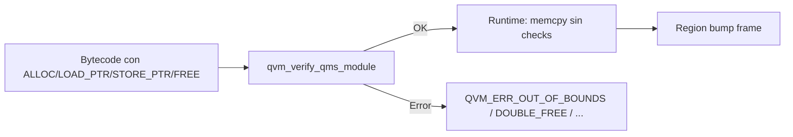

# QMS-Zero — memoria de coste cero

> Nombre canónico en el repositorio: **QMS-Zero** (*QVM Memory System — Zero overhead*). A veces se escribe `QSM-Zero` en conversaciones; no aparece así en código, commits ni tests.
> Fuentes: `include/qvm/memory.h`, `include/qvm/memory_verifier.h`, `src/verifier/verifier_qms.c`, `src/verifier/memory_verifier.c`, `src/runtime/runtime.c`, `src/runtime/runtime_fast.c`.

## 1. Idea central

QMS-Zero traslada la comprobación de seguridad de la ejecución a la carga. Un verificador estático analiza el bytecode y garantiza que los accesos a memoria son seguros; el runtime puede entonces leer y escribir con `memcpy` directo, sin comprobar límites ni estados en cada instrucción.



Esta decision tiene una consecuencia importante: **el contrato de seguridad es condicional**. Si se ejecuta bytecode que no pasó por el verificador, o si verificador y runtime discrepan en la codificación, el acceso se convierte en una desreferencia cruda y el comportamiento es indefinido.

## 2. Modelo de datos

### 2.1 Regiones

`qvm_region_id` (`include/qvm/memory.h:12-23`):

| Región | ID | Vida |
|:---|---:|:---|
| `QVM_REGION_GLOBAL` | 0 | Toda la ejecución del contexto |
| `QVM_REGION_MODULE` | 1 | Bytecode y constantes del módulo |
| `QVM_REGION_FRAME` | 2 | Locales del frame; limpieza O(1) al retornar |

`qvm_region {id, base, capacity, offset}` usa *bump allocation*: `qvm_region_init`, `qvm_region_destroy` y `qvm_region_alloc` (`memory.h:38-44`). La implementación asume que el verificador ya descartó el agotamiento de capacidad.

### 2.2 Punteros

`qvm_ptr {region_id, offset, size, type_id}` (`memory.h:31-36`) es un tipo lineal con estado en el verificador y se resuelve a un puntero C en runtime. El estado estático es `UNINIT`, `OWNED`, `BORROWED` o `CONSUMED` (`include/qvm/memory_verifier.h:11-17`).

Los helpers son deliberadamente "sin checks" (`memory.h:46-60`):

```c
static inline void *qvm_ptr_to_raw(const qvm_region *region, const qvm_ptr *ptr) {
    return region->base + ptr->offset;
}
static inline void qvm_ptr_read(const qvm_region *region, const qvm_ptr *ptr,
                                void *dst, uint32_t len) {
    __builtin_memcpy(dst, region->base + ptr->offset, len);
}
```

### 2.3 Región del runtime

`qvm_runtime_create` reserva **1 MiB** con `malloc` para `frame_region` y la inicializa como `QVM_REGION_FRAME` (`src/runtime/runtime.c:48-52`). `qvm_runtime_destroy` la libera (`runtime.c:66`). No se usa GCQ para esta región.

## 3. Opcodes de memoria

Definidos en `include/qvm/instruction.h:59-65`: `ALLOC 0x70`, `FREE 0x71`, `LOAD_PTR 0x72`, `STORE_PTR 0x73`.

| Opcode | Efecto en el intérprete | Coste |
|:---|:---|:---|
| `ALLOC` | `qvm_region_alloc` sobre `frame_region`; guarda un `qvm_ptr` en `payload` con `QVM_TYPE_PTR` (`runtime.c:216-237`) | Bump O(1) |
| `FREE` | No libera memoria: escribe un `qvm_ptr` cero para marcar lógicamente el consumo (`runtime.c:243-260`) | O(1) |
| `LOAD_PTR` | `memcpy` de 4 bytes desde `base + ptr.offset + imm32` (`runtime.c:264-287`) | Sin checks |
| `STORE_PTR` | `memcpy` de 4 bytes hacia esa dirección (`runtime.c:293-317`) | Sin checks |

El fast path (`src/runtime/runtime_fast.c:20-33`) implementa `LOAD_PTR`, `STORE_PTR`, `ADD`, `CMP_LT`, `JMP_IF` y `RETURN` mediante *computed goto*; **no implementa** `ALLOC`/`FREE` ni `LOAD_CONST` (`runtime_fast.c:152-153`). Por tanto, un módulo con `ALLOC` debe ejecutarse con `qvm_runtime_execute`.

## 4. Verificador estático

Hay dos capas complementarias:

1. **Reglas de estado** (`src/verifier/memory_verifier.c`):
   - `qvm_mem_verify_alloc` (`:20-43`): registro válido, tamaño no nulo; reasignar un `OWNED` produce `QVM_ERR_MEMORY_LEAK`.
   - `qvm_mem_verify_free` (`:45-58`): solo `OWNED`; `CONSUMED` ⇒ `DOUBLE_FREE`, `BORROWED` ⇒ `INVALID_BORROW`, resto ⇒ `USE_AFTER_FREE`.
   - `qvm_mem_verify_load` (`:60-77`) y `qvm_mem_verify_store` (`:79-95`): rango de registro, estado, y comprobación `offset + len > size` ⇒ `OUT_OF_BOUNDS`.

2. **Verificación del módulo** (`qvm_verify_qms_module` en `src/verifier/verifier_qms.c:13-102`): una pasada lineal sobre `pc` que mantiene `qvm_reg_state {size, is_owned, is_valid}` por registro. Detecta fuga en `ALLOC`, doble free/UAF en `FREE` y UAF o desbordamiento en `LOAD_PTR` (con `access_size = 4` fijo). Incluye el `PC` en el mensaje de error.

Las tres pruebas de `tests/verifier/test_qms_zero.c:16-93` cubren acceso válido, desbordamiento y doble free. `tests/runtime/test_qms_runtime.c` solo construye bytecode; `examples/test_qms_simple.c` sí ejecuta un bucle y devuelve `5` como resultado esperado.

## 5. Limitaciones y contrato de seguridad

Los siguientes puntos son verificables en el código y deben tenerse presentes antes de usar QMS-Zero en producción:

- [ ] **Divergencia de codificación**: el verificador lee `offset` en big-endian y avanza 8 bytes en `LOAD_PTR` (`verifier_qms.c:71-90`); el fast path lo lee en little-endian y avanza 9 (`runtime_fast.c:64-73`). `ALLOC` aparece con 8 y 9 bytes en distintos tests.
- [ ] **`STORE_PTR` no se verifica**: cae en el `default: pc += 4` de `verifier_qms.c:94-96`.
- [ ] `region_limits` se declara pero no se usa; la rama `FRAME` está vacía en `memory_verifier.c:31-36`; `BORROWED` nunca se produce.
- [ ] `offset + len` puede desbordar `uint32_t` (`memory_verifier.c:70`, `:90`).
- [ ] El runtime ignora `region_id`, `size` y `type_id` del `qvm_ptr` en el acceso: siempre usa `frame_region.base`.
- [ ] `FREE` no recicla memoria: la región solo crece hasta agotar 1 MiB, sin control en `runtime.c:220`.
- [ ] Los códigos de error QMS-Zero se definen dos veces con valores solapados en `include/qvm/error.h:40-63`.
- [ ] El verificador general `src/verifier/verifier.c:6-36` calcula tamaños de instrucción QMS-Zero distintos del decoder.

**Contrato**: ejecutar solo bytecode aceptado por `qvm_verify_qms_module`, con la misma codificación en verificador y backend elegido, y dentro de la capacidad de la región. Bajo ese contrato, los accesos son seguros por construcción y no necesitan checks en caliente. Fuera de él, QMS-Zero no ofrece protección en runtime.

## 6. Relación con GCQ

GCQ (`include/qvm/gcq.h`, `src/memory/gcq/gcq.c`) es un subsistema separado: allocator con límite de 64 MiB por defecto, contabilidad de bloques y `gcq_region_release` en O(n). QMS-Zero usa bump allocation O(1) y no llama a GCQ. Son modelos alternativos, no una jerarquía.

## 7. Rendimiento observado

Bucle de 100 M iteraciones con `LOAD_PTR → ADD → STORE_PTR → LOAD_PTR → CMP_LT → JMP_IF`, compilado en `Release`, una sola medición:

| Modo | M iter/s | Tiempo |
|:---|---:|---:|
| Registros, fast path | 73.49 | 1.3608 s |
| QMS-Zero, fast path | 45.30 | 2.2075 s |
| Intérprete, registros | 22.97 | 0.4354 s |
| Intérprete, QMS-Zero | 11.71 | 0.8538 s |

El coste adicional de los accesos a memoria es de ~1.6x sobre registros en el fast path y ~1.96x en el intérprete. La ventaja de QMS-Zero no es velocidad frente a registros, sino **eliminar comprobaciones en caliente manteniendo verificación previa**. Detalles y reproducibilidad en [benchmarks.md](benchmarks.md).

## 8. Uso recomendado

1. Generar bytecode con los cuatro opcodes QMS-Zero usando la codificación del decoder (`instruction.h` / `decode.c`).
2. Llamar a `qvm_verify_qms_module(bytecode, size, register_count)` antes de ejecutar.
3. Crear contexto, módulo y runtime; inicializar el frame con registros `QVM_TYPE_PTR`/`I32` según corresponda.
4. Ejecutar con `qvm_runtime_execute` si el bytecode contiene `ALLOC`/`FREE`; usar `qvm_runtime_execute_fast` solo para el subset soportado.
5. No usar QIT/JIT como backend para bytecode QMS-Zero: esos compiladores no soportan `ALLOC`, `FREE`, `LOAD_PTR` ni `STORE_PTR`.
